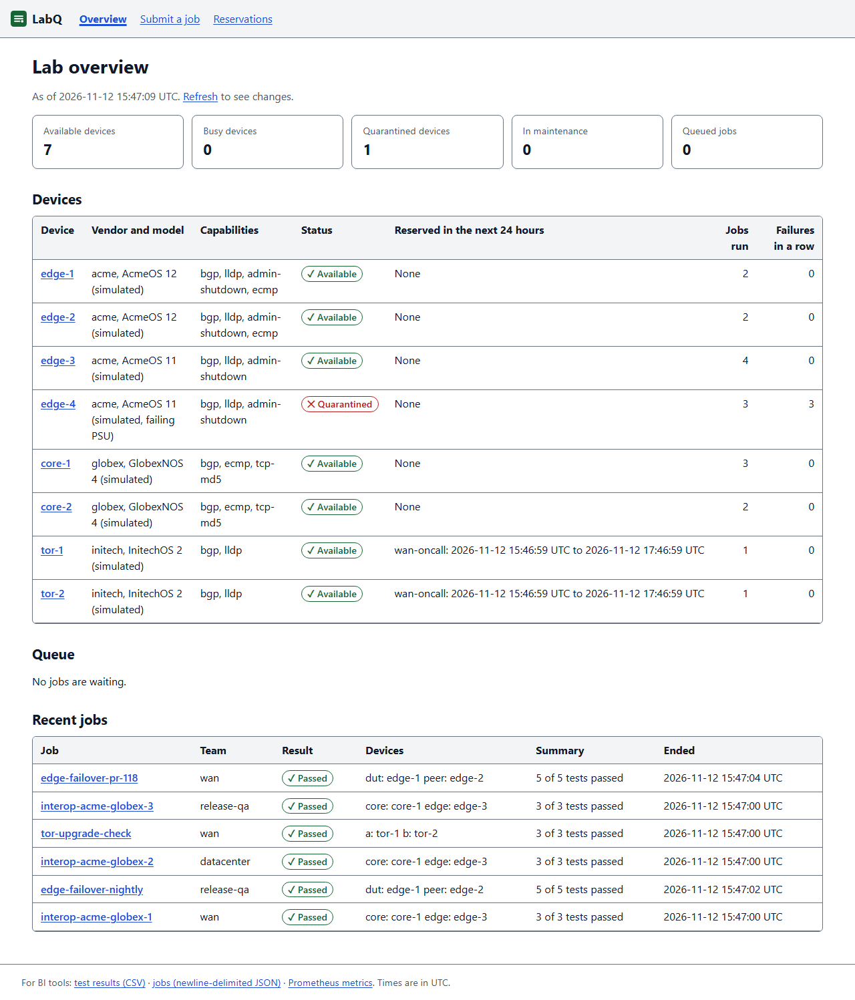
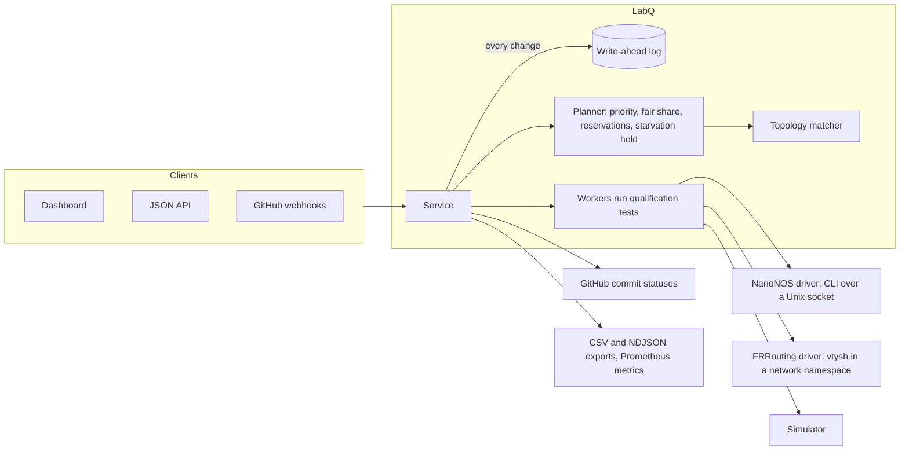
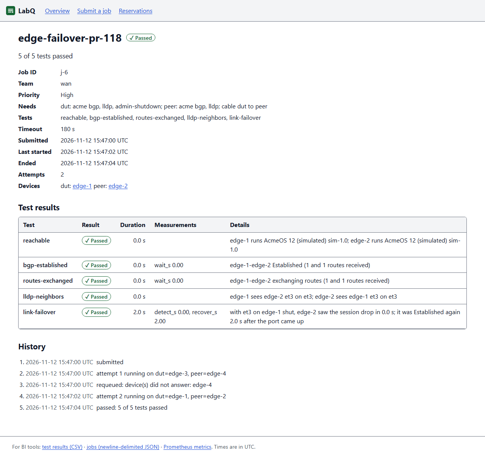
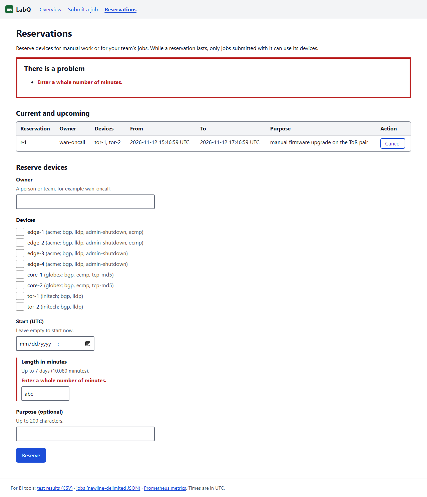

# LabQ

[](https://github.com/yasaswinivardhireddy-png/labq/actions/workflows/ci.yml)

A scheduler and queueing system for network test labs, in Go (standard library only). LabQ puts
every lab device behind one API, matches jobs to devices by vendor, capability and cabling, queues
them fairly across teams, runs qualification tests (BGP, LLDP, link failover) on real network
software, and connects to GitHub, BI tools and dashboards.

Network teams qualify features on a small pool of scarce devices. A job needs particular vendors
and particular cables between them, teams compete for the same devices, people reserve devices for
manual work, and devices hang or crash in the middle of a run. LabQ keeps jobs in a queue until a
matching set of devices is free, works around a device that stops answering instead of failing
someone's test, and writes every change to a write-ahead log, so a crash loses nothing.

CI runs LabQ on two [NanoNOS](https://github.com/yasaswinivardhireddy-png/nanonos) switches (my
C++20 SONiC-style switch OS) and an FRRouting router, cabled together in Linux network namespaces.



## Results

Every CI run boots the lab and drives it through LabQ's API with [scripts/lab.sh](scripts/lab.sh).
Each step is checked, and the run fails if any check fails. From a
[CI run](https://github.com/yasaswinivardhireddy-png/labq/actions/workflows/ci.yml):

| Scenario | What LabQ did |
|---|---|
| Three jobs need the same switch: an interop run (eBGP with TCP-MD5 between NanoNOS and FRRouting 8.4), a fabric run, and a run started by a signed GitHub push webhook | Ran them one at a time on nanonos-1 (the third waited about 5 s) and all passed. The push run set the `labq/qualification` commit status to success on GitHub. A webhook with a bad signature got HTTP 401 |
| Link failover: shut a port on one switch | The other switch saw the BGP session drop within the 3 s hold time (after 2.3 to 3.0 s), and the session was Established again 1.0 s after the port came back |
| nanonos-2 crashes (SIGKILL) | The job ran 3 times and ended as a lab error, not a test failure. nanonos-2 was quarantined after 3 strikes; nanonos-1, its partner in the job, was not blamed |
| A job queues for the quarantined switch, then LabQ itself is killed with SIGKILL and restarted | LabQ replayed 39 events from its write-ahead log; the queued job and the quarantine were still there |
| An operator restarts nanonos-2 and marks it available | The queued job ran straight away and passed |

Tests poll devices every 250 ms, so timings are accurate to about 0.25 s.

Also in CI: 40 Go tests with the race detector, including a property test that checks the device
matcher against brute force on 3,000 random labs; 60 s of fuzzing of the write-ahead log decoder;
govulncheck; and 4 Playwright tests that check every dashboard page with axe (WCAG 2.2 AA) and test
keyboard-only use, reflow at 320 px and forced colors.

## How it works



**Device abstraction.** The scheduler and the tests use only this interface; drivers translate it
to each device's own management interface:

```go
type Device interface {
	Info(ctx context.Context) (Info, error) // OS, version, hostname
	BGPPeers(ctx context.Context) ([]BGPPeer, error)
	LLDPNeighbors(ctx context.Context) ([]Neighbor, error)
	SetInterfaceAdmin(ctx context.Context, port string, up bool) error
}
```

The NanoNOS driver speaks its JSON CLI over a Unix socket. The FRRouting driver runs vtysh inside
the router's network namespace and parses both JSON layouts that FRR versions print. The simulator
backs the demo and the tests. A driver returns `ErrUnreachable` when a device does not answer, and
that is how LabQ tells a broken lab from a broken feature.

**Matching.** A job names roles (for example `dut`: vendor `nanonos` with `bgp`, `lldp` and
`admin-shutdown`) and the cables it needs between roles. LabQ assigns devices by backtracking: it
fills the most constrained role first, checks cables as soon as both ends are placed, and prefers
devices with fewer capabilities and fewer jobs run, so versatile devices stay free and wear evens
out. A property test checks it against brute force on 3,000 random labs.

**Queueing.** Each pass orders queued jobs by priority, then by fair share (the team's running jobs
divided by its weight), then by age, and starts every job that gets a full set of devices.
Reservations hold devices for a person or team for a time window; overlapping reservations are
rejected, and a job can run inside its own reservation. A job may only take a device that is free
of other reservations for its whole timeout. When a job has waited 15 minutes and still cannot
start, LabQ holds the devices it could use as they free up, so a stream of small jobs cannot starve
a big one.

**Failures.** A test fails when the feature misbehaves. When a device does not answer, the job
stops with a lab error instead, LabQ requeues it (up to 3 attempts), and the device gets a strike;
3 strikes in a row quarantine it until someone returns it to service. The failover test always
restores the port it shut, even when the job is cancelled or times out.

**Durability.** State changes only by applying events (job submitted, devices assigned, test
result, job finished, device status changed, reservation made, and so on). Each event is applied
and appended to the write-ahead log as one CRC-32C-checked JSON line, fsynced before LabQ acts on
it; for example, an assignment is on disk before the job's tests start. On start, LabQ replays the
log, cuts off a torn last record, and requeues jobs that were running when it stopped. A test
checks that replaying the log rebuilds exactly the same state.

**Integrations.**

- **GitHub.** `POST /api/v1/github/webhook` takes `push` and `pull_request` deliveries, verifies
  `X-Hub-Signature-256` (HMAC-SHA256, constant-time comparison), queues the configured preset for
  the commit, and sets the commit status (pending, then success, failure or error). Status updates
  retry server errors and rate limiting with backoff.
- **BI tools.** `/api/v1/export/results.csv` has one row per test result, with measurements and
  queue wait. `/api/v1/export/jobs.ndjson` has one row per job in a fixed schema,
  [bigquery_schema.json](internal/integrations/bigquery_schema.json): times that have not happened
  are null, lists are never null, and measurements are name/value pairs, because their names differ
  from test to test. A test checks every exported row against the schema. To load it:
  `bq load --source_format=NEWLINE_DELIMITED_JSON lab.jobs jobs.ndjson internal/integrations/bigquery_schema.json`.
- **Dashboards.** `/metrics` serves Prometheus metrics: devices by status, jobs by state, test
  results by test and outcome, and queue wait.

**Dashboard.** Server-rendered HTML with no JavaScript: lab overview, job and device pages, a job
form and reservations. It is built to WCAG 2.2 AA: a skip link, labelled forms with an error
summary that links to each field, status shown as text and icon rather than color alone, tables
with captions and header scopes, visible focus, and layouts that reflow at 320 px and work in
forced-colors mode. Cross-site form posts are rejected, and pages send a strict Content Security
Policy.

| Job page | Form errors |
|---|---|
|  |  |

## API

| Method and path | Purpose |
|---|---|
| `GET /api/v1/devices` | Devices, their status and cabling |
| `POST /api/v1/devices/{id}/status` | Return a device to service, or put it in maintenance or quarantine |
| `GET /api/v1/jobs`, `GET /api/v1/jobs/{id}` | Jobs, newest first (filter with `?state=`); one job with its results and queue position |
| `POST /api/v1/jobs` | Submit a job: a full spec, or `preset` with a name, team and priority |
| `POST /api/v1/jobs/{id}/cancel` | Cancel a queued or running job |
| `GET /api/v1/reservations`, `POST /api/v1/reservations`, `DELETE /api/v1/reservations/{id}` | List, make and cancel reservations |
| `GET /api/v1/tests` | The qualification tests |
| `POST /api/v1/github/webhook` | GitHub deliveries |
| `GET /api/v1/export/results.csv`, `GET /api/v1/export/jobs.ndjson` | Exports for BI tools |
| `GET /metrics`, `GET /healthz` | Prometheus metrics and health |

Errors are RFC 9457 problem details, with a message for each invalid field.

## Run it

A simulated eight-device lab with a reservation, a failing device and some jobs:

```sh
go run ./cmd/labq demo          # then open http://127.0.0.1:8080
```

The real lab from CI, on Linux as root (needs FRRouting, iproute2, ethtool, jq and a C++20
compiler for NanoNOS):

```sh
git clone https://github.com/yasaswinivardhireddy-png/nanonos
cmake -S nanonos -B nanonos/build -G Ninja -DCMAKE_BUILD_TYPE=Release -DNANONOS_BUILD_TESTS=OFF
cmake --build nanonos/build
go build -o labq ./cmd/labq
NANONOS=$PWD/nanonos/build LAB_KEEP=1 sudo -E scripts/lab.sh   # dashboard at http://127.0.0.1:8080
```

For your own lab, describe the devices, cables, teams and presets in a file like
[configs/lab.json](configs/lab.json), then run `labq serve -config lab.json`. Set `GITHUB_TOKEN`
for commit statuses and `LABQ_WEBHOOK_SECRET` to accept webhooks.

```sh
curl -s localhost:8080/api/v1/jobs -H 'Content-Type: application/json' \
  -d '{"name": "bgp-check", "preset": "interop", "team": "wan", "priority": 1}'
curl -s localhost:8080/api/v1/jobs/j-1
```

## Limitations

- One process runs one lab, and the log is never compacted.
- There is no authentication; run it behind your single sign-on proxy.
- The devices are software: NanoNOS and FRRouting in network namespaces, and a simulator. A driver
  for vendor hardware (over gNMI, NETCONF or SSH) would implement the same four methods.
- Fair share counts running jobs, not device-hours.

## Layout

| Path | What it is |
|---|---|
| `internal/lab` | The state: events, the planner and the matcher |
| `internal/device` | The device API and the NanoNOS, FRRouting and simulated drivers |
| `internal/qual` | The qualification tests |
| `internal/wal` | The write-ahead log |
| `internal/integrations` | GitHub webhooks and statuses, CSV and NDJSON exports |
| `internal/server` | The service, JSON API and dashboard |
| `cmd/labq` | The `serve` and `demo` commands |
| `configs`, `scripts/lab.sh` | The CI lab and its end-to-end scenario |
| `e2e` | Browser and accessibility tests |

## License

MIT
